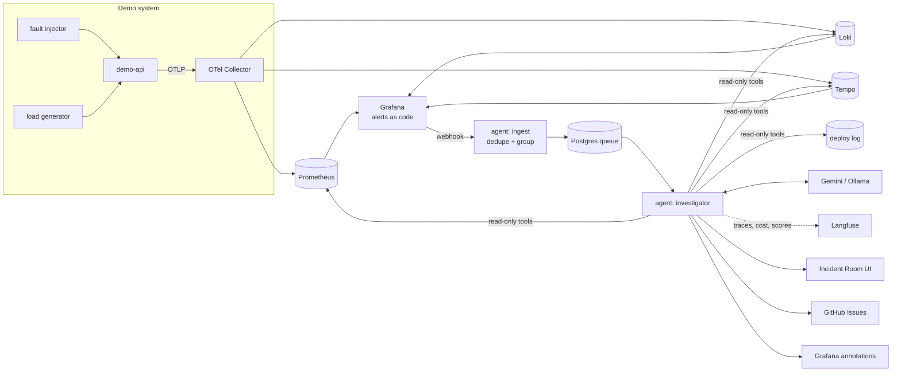

# Firstlook — implementation plan

Firstlook is an AI first responder for on-call. When an alert fires, it investigates the way a good engineer
does in their first ten minutes (metrics, logs, traces, recent changes), writes a triage note where every
claim links to its evidence, and stays on the incident until it resolves. It reads; it never changes anything.

This plan builds it in phases. **Every phase ends in something you can run and demo**, tagged as a release.

## Ground rules

- **GitHub from day one.** Work happens on short-lived branches (`phase-1/demo-service`, …), each merged to
  `main` through a pull request once CI is green. Every phase is a milestone; every deliverable is an issue.
- **Free to run.** Everything is open source and runs locally with `docker compose up`. The live demo uses
  free tiers only. The model is the Gemini free tier by default, with Ollama as a fully local option.
- **Read-only by design.** The agent's tools can query, never mutate. Safety is enforced by the platform
  (credentials, network policy), not just by the prompt.
- **Grounded or nothing.** Every claim in a triage note links to the query that proves it. Claims without
  evidence are dropped before the note is posted.
- **Measured.** Recorded incidents become an eval suite; quality is a number, tracked over time in Langfuse.

## Stack

| Concern | Choice |
|---|---|
| Language | TypeScript (Node 22), pnpm workspaces monorepo |
| Demo service | Small HTTP API instrumented with OpenTelemetry, with fault injection |
| Telemetry | OpenTelemetry Collector → Prometheus (metrics), Loki (logs), Tempo (traces) |
| Dashboards + alerts | Grafana, provisioned with Terraform (`grafana/grafana` provider) |
| Agent state + queue | Postgres (`SKIP LOCKED` job queue, incidents, steps, feedback) |
| LLM | Gemini (free tier) via a provider interface; Ollama and a deterministic mock for tests |
| LLM observability + evals | Langfuse (traces, cost, scores, datasets) |
| UI | Incident Room: Next.js app with live updates (server-sent events) |
| Outputs | Incident Room, GitHub Issues, Grafana annotations; ntfy and Slack as optional adapters |
| Runtime | Docker Compose (dev) → Helm chart on k3s (live) |
| CI | GitHub Actions: lint, typecheck, tests, evals, image builds, Helm lint, kind smoke test |

## Architecture

## Phases

### Phase 0 — Foundations · `v0.0.1`
Get the repo, tooling and CI in place before any feature work.

- Monorepo scaffold: `apps/demo-api`, `apps/agent`, `apps/web`, `packages/shared`, `infra/`
- Tooling: pnpm workspaces, TypeScript project refs, ESLint, Prettier, Vitest
- CI: install, lint, typecheck, test on every PR; status badge in the README
- Repo hygiene: MIT license, issue and PR templates, labels, milestones, CODEOWNERS, Dependabot

**Done when:** a PR with a trivial change goes green in CI and merges.

### Phase 1 — An observable system to break · `v0.1.0`
A small service worth monitoring, the full telemetry stack, and alerts defined as code.

- `demo-api`: a bookings-style API (Postgres-backed) with OpenTelemetry metrics, structured logs and traces
- `payments-stub`: a downstream dependency the API calls (so "it's them, not us" is a real scenario)
- Load generator producing realistic, steady traffic
- Fault injector with four scenarios: **bad deploy** (slow query), **dependency outage** (503s),
  **memory leak** (rising memory, restarts), **noisy blip** (short spike that recovers)
- Deploy log: every scenario that changes the service records a deploy event (version, commit, time)
- Compose stack: OTel Collector, Prometheus, Loki, Tempo, Grafana, Postgres
- Terraform (Grafana provider): data sources, a service dashboard, P95/P99 latency, error-rate and
  saturation alert rules, and a webhook contact point
- A stub webhook receiver that logs alerts, to prove the wiring

**Done when:** `docker compose up`, trigger "bad deploy", watch the dashboard spike and the alert reach the stub.

### Phase 2 — The investigator · `v0.2.0`
The agent itself: from alert to grounded triage note.

- Ingest: webhook endpoint with signature check, dedupe (fingerprint + window), grouping of related alerts
  into one incident, flap detection
- Postgres job queue with `SKIP LOCKED`, retries with backoff, idempotency keys
- Read-only tools, each returning data plus a **deep link** that reproduces it in Grafana:
  - `metric_overview` (shape, onset, baseline comparison)
  - `metric_breakdown` (by route, status, pod)
  - `error_logs` (around onset, grouped by signature)
  - `slow_traces` (slowest spans and where time goes)
  - `recent_changes` (deploys and config changes before onset)
  - `dependency_health` (downstream error rates and latency)
- Investigation loop with hard budgets (max steps, tokens, wall time) and a fixed playbook to start from
- Triage note schema: summary, likely cause, confidence, evidence (claim → link), ruled out, next step,
  runbook link. Claims whose evidence doesn't verify are dropped.
- Prompt-injection hardening: tool output is quoted data, never instructions; log lines are truncated and
  escaped; the model can only call the declared tools
- Langfuse tracing for every investigation (steps, tool calls, tokens, cost, latency)
- LLM provider interface: Gemini, Ollama, and a deterministic mock used by tests

**Done when:** each of the four scenarios produces a stored triage note naming the right cause, with valid links.

### Phase 3 — Incident Room and outputs · `v0.3.0`
Make it visible and interactive, with no Slack required.

- Incident Room web app: incident list, live timeline, the investigation streaming step by step (each
  step expandable to its query and result), the triage note card, and a follow-up question box
- "Break it" panel: trigger a scenario (one at a time, rate-limited) and watch the whole loop
- Follow-ups: questions in the room run a short, budgeted investigation with the same tools
- 👍 / 👎 feedback stored and sent to Langfuse as a score
- Live updates on the incident as it recovers or worsens; automatic resolution
- Outputs: GitHub Issue per incident (note, then postmortem timeline as a comment), Grafana annotations;
  ntfy and Slack adapters behind the same interface, documented and off by default
- Postmortem draft generated on resolve

**Done when:** a visitor clicks "Bad deploy" and, within about a minute, sees the graph spike, the agent work,
the triage note appear, the GitHub issue open, and the Grafana annotation land.

### Phase 4 — Evals · `v0.4.0`
Turn "it seems to work" into a score.

- Recorded incidents: snapshots of telemetry and tool responses per scenario, replayable without the stack
- Graders: right cause identified, every evidence link valid, no invented numbers, correct "noise" verdicts,
  stays within budgets
- Langfuse dataset per scenario; experiment runs compare prompts and models (Gemini vs Ollama)
- CI: deterministic eval run on every PR (mock model + recordings); full model eval on demand
- Eval results table in the README, updated from the latest run

**Done when:** CI reports a pass rate per scenario, and a prompt change that breaks diagnosis fails the build.

### Phase 5 — Kubernetes · `v0.5.0`
Package it the way a platform team would ship it.

- Production Dockerfiles (multi-stage, non-root, small images), published to GHCR by CI
- Helm chart for Firstlook: agent ingest + workers, web, demo-api, payments-stub; values per environment
- Observability stack from upstream charts (Prometheus, Loki, Tempo, Grafana) as chart dependencies or a
  documented umbrella
- Security: read-only root filesystem, non-root, no service account token, NetworkPolicies that let the agent
  reach only the query APIs, the model API and its outputs, resource requests and limits, probes
- CI: `helm lint`, chart tests, and a kind cluster smoke test (install, inject a fault, assert a triage note)

**Done when:** `helm install` on a fresh kind cluster runs the full loop, and CI proves it on every PR.

### Phase 6 — Live demo · `v1.0.0`
A public link anyone can try.

- k3s on a free-tier VM (Oracle Cloud Always Free ARM), provisioned with Terraform where the provider allows
- TLS and ingress (Traefik + cert-manager), secrets via sealed or external secrets
- Deploy pipeline: tagged release → images → `helm upgrade` (GitHub Actions with a scoped deploy key)
- Public safety: demo-mode limits (one scenario at a time, per-IP rate limits, daily model budget), Langfuse
  Cloud free tier if self-hosting is too heavy for the VM
- README: live link, 90-second GIF, architecture, eval results, design decisions

**Done when:** the live link works end to end for a stranger, and the README tells the story without a click.

### Phase 7 — Stretch
- Argo CD (GitOps) instead of push-based deploys
- KEDA scaling of investigator workers on queue depth
- "Approve to run": one safe action (`helm rollback`) behind explicit human approval and an audit log
- Grafana MCP server as an alternative tool backend
- Optional Terraform module to run the same containers on AWS

## Definition of done for every change
- CI green: lint, typecheck, tests (and evals from Phase 4)
- Docs updated where behaviour changes
- No secrets in the repo; config through environment variables with an `.env.example`

## Risks and how the plan handles them
| Risk | Mitigation |
|---|---|
| Agent guesses instead of investigating | Evidence-or-drop rule, graders for invented numbers, fixed playbook to start from |
| Free-tier limits (model, VM) | Budgets per investigation, mock/recorded mode for CI, Ollama fallback |
| Prompt injection via logs | Tool output treated as data, escaping, read-only credentials, network policy |
| Kubernetes eats the schedule | Compose first; Kubernetes only after the agent is good (Phase 5) |
| Self-hosted Langfuse too heavy for a small VM | Langfuse Cloud free tier for the live demo |
